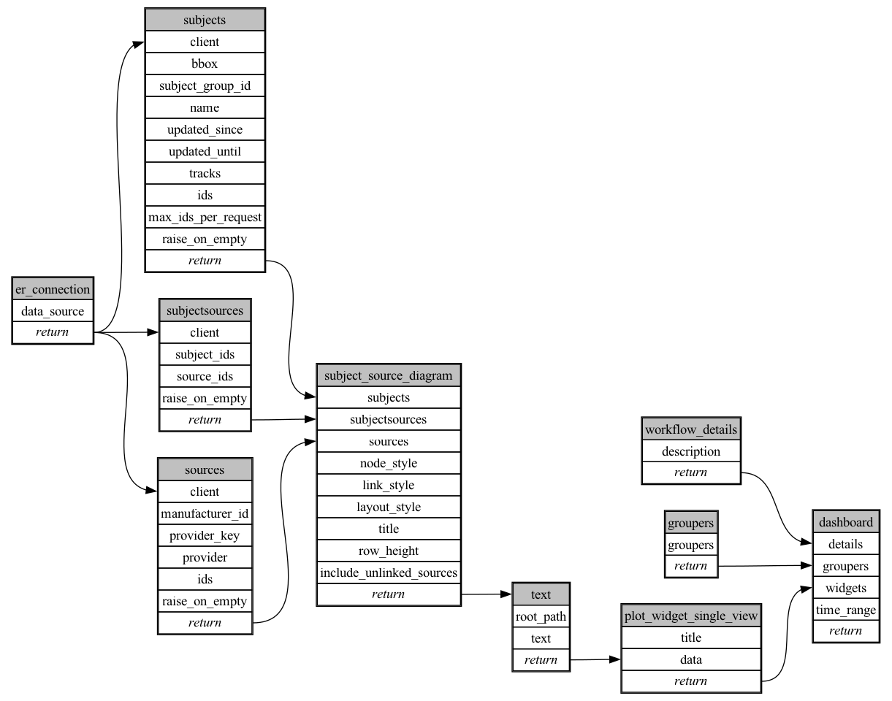

```
# AUTOGENERATED BY ECOSCOPE-WORKFLOWS; see fingerprint in README.md for details

```

```yaml
# fingerprint:
artifacts_sha256_basic: 2c0a400b9bd521d1e6537aa61b1355892f5fd3c0ad80d9d580252f96ebdc9e96
artifacts_sha256_strict: 96dd7b8bf94c1e9cb8446e7dd047ee322050ee20bab2df15939d853f0a33f949
installed_requirements:
- channel: https://repo.prefix.dev/ecoscope-workflows/
  name: ecoscope-platform
  version: {version: ==2.25.0}
- channel: conda-forge
  name: pydeck
  version: {version: ==0.9.2}
- channel: conda-forge
  name: setuptools
  version: {version: ==81.0.0}
- channel: https://repo.prefix.dev/ecoscope-workflows-custom/
  name: ecoscope-workflows-ext-ste
  version: {version: ==0.0.0rc1}
- channel: https://repo.prefix.dev/ecoscope-workflows-custom/
  name: ecoscope-workflows-ext-custom
  version: {version: ==0.1.0rc14}
- channel: https://repo.prefix.dev/ecoscope-workflows-custom/
  name: ecoscope-workflows-ext-mep
  version: {version: ==1.0.5}
params_sha256: e9a35340031e259648889ce3cfb06fe85dec5b030a3b68287cf33e77f181b53c
spec_sha256: 4078dbdb5e4c165e2a4aa7559f27d5af067c2b409bec26d453c3fa79681c203d

```

# ecoscope-workflows-subject-tracking-data-qa-workflow


