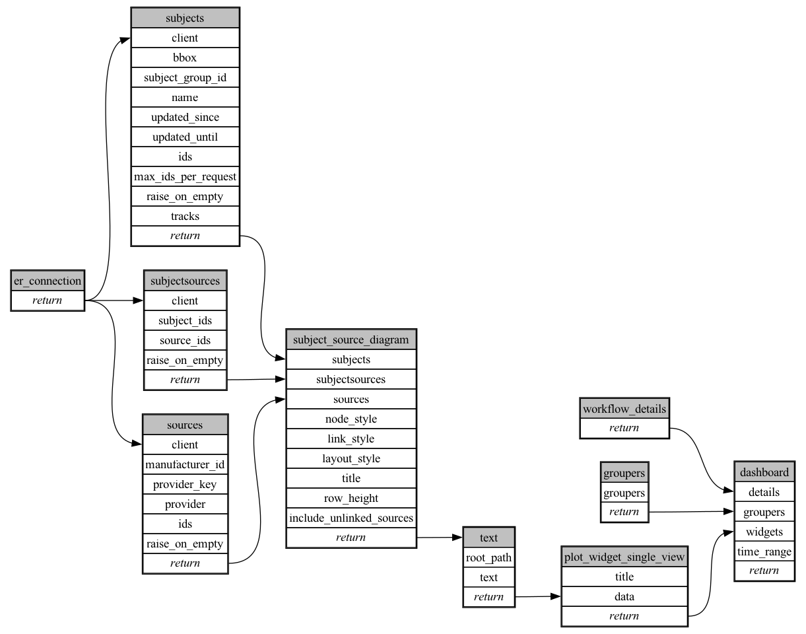

```
# AUTOGENERATED BY ECOSCOPE-WORKFLOWS; see fingerprint in README.md for details

```

```yaml
# fingerprint:
artifacts_sha256_basic: 908e34445f174b00435654959d7c18c4c7feb47eded3bf14e52fa01350f0083d
artifacts_sha256_strict: 1e41a39002aa87401d7bd8dc75db1cc64cfe18d50c0200711b9aa3b639b09423
installed_requirements:
- channel: https://repo.prefix.dev/ecoscope-workflows/
  name: ecoscope-platform
  version: {version: ==2.25.3}
- channel: conda-forge
  name: pydeck
  version: {version: ==0.9.2}
- channel: conda-forge
  name: setuptools
  version: {version: ==81.0.0}
- channel: https://repo.prefix.dev/ecoscope-workflows-custom/
  name: ecoscope-workflows-ext-ste
  version: {version: ==0.0.24}
- channel: https://repo.prefix.dev/ecoscope-workflows-custom/
  name: ecoscope-workflows-ext-custom
  version: {version: ==0.1.4}
- channel: https://repo.prefix.dev/ecoscope-workflows-custom/
  name: ecoscope-workflows-ext-mep
  version: {version: ==1.10.7}
params_sha256: 036c72f3ebbce78c722a0d51db4e47c36d8c43e0be9d4081e89976ce41e16e0f
spec_sha256: 55da572d0052f798ad902cf4ab93075d3db2c55ed86eb8794a0beeb85f62db2c

```

# ecoscope-workflows-subject-tracking-master-plot-workflow


