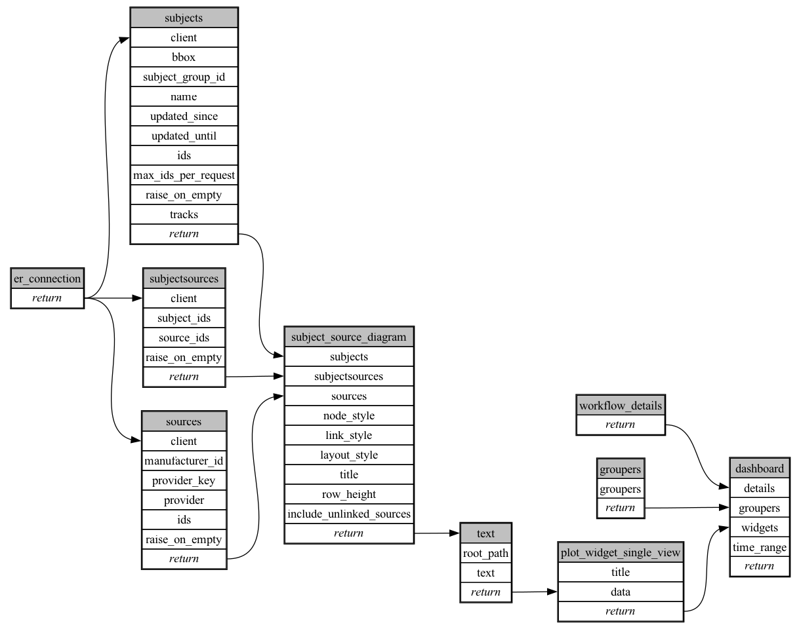

```
# AUTOGENERATED BY ECOSCOPE-WORKFLOWS; see fingerprint in README.md for details

```

```yaml
# fingerprint:
artifacts_sha256_basic: eeafd0f494375c410163ff076771686e8491f9904973c4a5334e7d9a9a427c97
artifacts_sha256_strict: cbcab97b047da6f25977e3b868d6ffbc10ff01281547143f1912690898d1a551
installed_requirements:
- channel: https://repo.prefix.dev/ecoscope-workflows/
  name: ecoscope-platform
  version: {version: ==2.25.3}
- channel: conda-forge
  name: pydeck
  version: {version: ==0.9.2}
- channel: conda-forge
  name: setuptools
  version: {version: ==81.0.0}
- channel: https://repo.prefix.dev/ecoscope-workflows-custom/
  name: ecoscope-workflows-ext-custom
  version: {version: ==0.1.6}
params_sha256: 036c72f3ebbce78c722a0d51db4e47c36d8c43e0be9d4081e89976ce41e16e0f
spec_sha256: 8cfe6474d5a60a40109a5d7880462effbd5100a8ddd7bce181344e757901c296

```

# ecoscope-workflows-subject-tracking-master-plot-workflow


